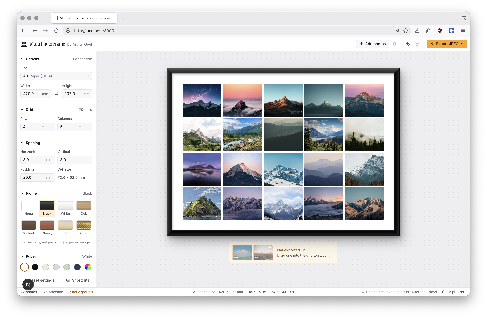

# Multi Photo Frame

Turn a pile of photos into a single print-ready gallery wall image.

Pick a paper size (A3, A4, or custom), choose a grid, add your photos, and tweak spacing, padding and paper colour. Preview it in a frame, then export one high-resolution JPEG (300 DPI) to send to a print shop and put in a frame.

Everything runs in your browser. Your photos never leave your device.



## Running it

Requires [Bun](https://bun.sh).

```bash
bun install
bun dev
```

Then open <http://localhost:3000>.

### Production build

```bash
bun run build   # static site is written to ./out
bun start       # serves ./out locally
```

### Checks

```bash
bun run check   # typecheck, lint and tests
bun run test    # tests only
```
